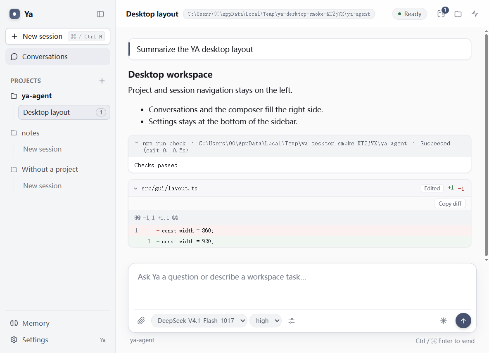
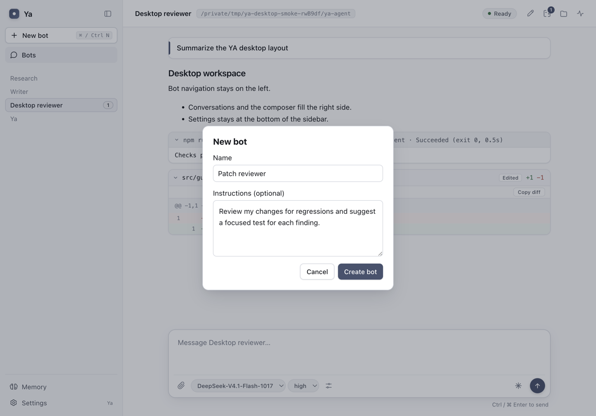
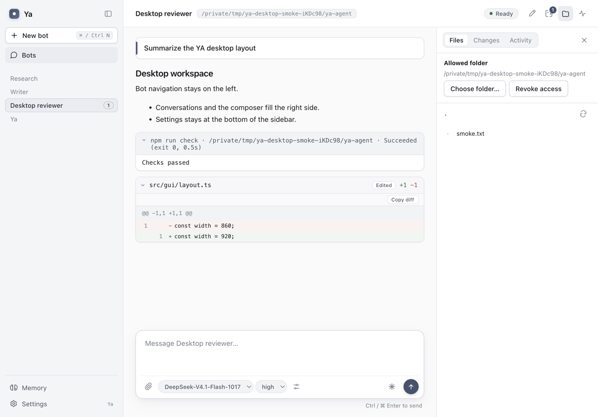
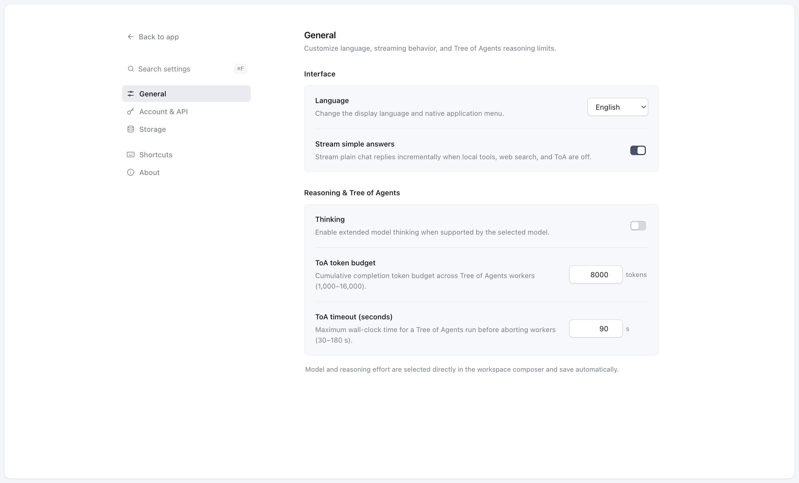

# Ya

[English](README.md) | [中文](README.zh-CN.md)

Ya (丫丫) is a desktop and CLI agent for DeepSeek built around **persistent named bots instead of disposable sessions**.

Rather than opening throwaway chat sessions, you keep dedicated bots for recurring jobs—each with its own name, optional standing instructions, ongoing conversation history, drafts, and folder access. Ya defaults to `DeepSeek-V4.1-Flash-1017` (with vision) and supports `DeepSeek-V4-Pro-0813`, stores long-term memory locally in SQLite via Octop Memory, shows diffs before changing files, and offers a CLI for one-off tasks and shell verification (`--local --exec`).

## Desktop preview

Work directly with the default **Ya** bot or create named bots for ongoing projects and roles. Pick any bot in the sidebar to continue right where you left off; inspect its folder, file diffs, recalled memory, tool activity, and pending approvals in the right-hand panel.



## Highlights

- **Bots instead of sessions:** create named bots with optional standing instructions, keep each bot's drafts, conversation history, and file diffs across restarts, and switch between bots instead of starting throwaway chats.
- **Built for DeepSeek:** supports `deepseek-flash` (`DeepSeek-V4.1-Flash-1017`, vision) and `deepseek-v4-pro` (`DeepSeek-V4-Pro-0813`), thinking effort (`low`, `high`, `max`), browser platform-account sign-in (PKCE), and API keys.
- **Per-bot folder access & diff approval:** desktop bots start with no filesystem access until you grant one folder; file tools cannot delete files and show diffs before writing; CLI shell execution (`--local --exec`) and ToA require separate confirmation.
- **Reviewable local memory:** feedback after an answer creates candidate memory cards in local SQLite (`octop-memory==1.0.4`); only cards you approve are recalled in future tasks.
- **Web search & Tree of Agents (ToA):** optional web search runs at most one follow-up pass when key evidence is missing, and ToA coordinates up to two temporary workers under explicit token and timeout limits after confirmation.
- **Desktop app & CLI:** both interfaces share config, auth, memory, and cross-process task history; the Electron renderer has no direct Node.js or filesystem access and talks to the main process over a narrow preload bridge.

## Quick start

### 1. Install

Download standalone CLI or desktop binaries from the [latest GitHub Release](https://github.com/ZedingZhang/ya-agent/releases/latest) (see [Installation and standalone releases](docs/installation.md)), or install from source:

```sh
git clone https://github.com/ZedingZhang/ya-agent.git
cd ya-agent
npm ci
python -m pip install octop-memory==1.0.4
npm link
```

> [!NOTE]
> Source installs and npm tarballs require **Node.js 22+**. Long-term memory requires **Python 3.12+** with `octop-memory==1.0.4`. Building or testing the desktop app from source also requires **CMake 3.15+** and a C compiler.

### 2. Sign in to DeepSeek

- **Platform account (recommended, all platforms):** open **Settings → DeepSeek platform account → Sign in with DeepSeek** in the desktop app, or run `ya login deepseek` in the CLI.
- **API key:** export `DEEPSEEK_API_KEY`, store one in macOS Keychain via `ya auth deepseek`, or enter a session-only key in desktop **Settings**.

On macOS, both API keys and platform account grants are stored in Keychain; on Linux and Windows, platform account grants are stored as plaintext JSON (`~/.ya/auth/credentials.json`). See [Authentication, security boundaries, and networking](docs/security-and-auth.md) for storage and security details.

### 3. Run Ya

Launch the desktop app from source with `npm run gui`, or use the CLI directly:

```sh
ya ask "Explain this project"
ya ask --thinking on --reasoning-effort max "Compare these two designs"
ya ask --image ./chart.png "Explain this chart"
ya ask --local --exec --workspace "$PWD" "Fix the bug and run the relevant tests"
```

## Desktop app

- **Bots, not sessions:** start with **Ya** or press `Ctrl/⌘+N` (**New bot**) to give a bot a name and standing instructions; each keeps its own conversation history and draft, and you can edit its profile anytime via **Edit bot**.
- **Per-bot folder grants:** open **Files → Choose folder… → Grant access** to scope file tools to one directory and its subfolders, backed by native directory-identity checks where supported; replace or **Revoke access** anytime.
- **File diffs without Git:** successful `local_write` and `local_edit` actions render expandable inline diff cards and record per-operation history in **Changes**.
- **Workspace controls:** `Ctrl/⌘+B` toggles the sidebar, `Ctrl/⌘+Enter` sends a task, model and reasoning selectors save immediately, and **Task options** manages local tools, web search, ToA, and image detail. Bilingual **English / 简体中文** UI and **Memory** review are built in.
- **Boundary:** desktop bots use scoped file tools only; approved shell command execution (`--local --exec`) is available through the CLI.

<details>
<summary>More desktop screenshots</summary>

**New bot dialog** — configure a bot name and optional standing instructions:



**Bot folder access** — review, replace, or revoke a bot's scoped directory grant in the Files panel:



**Settings** — categorized full-frame Settings view with live bilingual search and immediate auto-save (`Ctrl/⌘+,`):



</details>

See the [Desktop application guide](docs/desktop.md) for full details on bot migration, diff limits, atomic writes, and IPC isolation.

## CLI at a glance

```sh
# Ask, stream, and pipe Markdown
ya ask "Explain recursion"
ya ask --web on "Compare recent benchmarks"
ya ask --format markdown "Create a concise table" > answer.md

# Vision input (deepseek-flash)
ya ask --image ./chart.png --image-detail high "Read this chart"

# Tree of Agents (prompts before starting; --yes for non-interactive)
ya ask --toa --toa-workers 2 "Evaluate this architecture trade-off"

# Local workspace tools and verified shell execution
ya ask --local --workspace "$PWD" "Summarize the notes directory"
ya ask --local --exec --workspace "$PWD" "Fix the bug and run the test suite"

# Configuration, memory, auth, and audit logs
ya config set model pro
ya config set thinking on
ya config set reasoning-effort max
ya memory review
ya memory approve CARD_ID
ya auth-status deepseek
ya audit clear
ya history clear tasks --older-than 30 --dry-run
```

### Models

| CLI alias | API model ID | Current model version | Image input |
| --- | --- | --- | --- |
| `flash` (default) | `deepseek-flash` | `DeepSeek-V4.1-Flash-1017` | Yes |
| `pro` | `deepseek-v4-pro` | `DeepSeek-V4-Pro-0813` | No |

> [!WARNING]
> `--local --exec` runs approved shell commands with your user account's permissions (not sandboxed—only the initial working directory is confined, with a default environment allowlist). Review commands and install scripts carefully before approving.

See the [CLI, tools, configuration, and memory reference](docs/cli-and-tools.md) for all flags, limits, `local_edit` semantics, and Octop Memory setup.

## Desktop vs. CLI

| Capability | Desktop GUI | CLI |
| --- | --- | --- |
| Persistent named bots & saved chat history | Yes | Single-task runs (shared durable task log) |
| Scoped workspace file tools & approval diffs | Yes (per-bot folder grant) | Yes (`--local`, optional `--approve`) |
| Approved shell command execution (`local_run`) | — | Yes (`--local --exec`, optional `--approve-commands`) |
| DeepSeek account sign-in & vision input | Yes | Yes |
| Web search, ToA preflight & thinking controls | Yes | Yes |
| Octop Memory review & pruning | Yes | Yes (`ya memory ...`) |

## Platform support

| Operating system | CLI | Desktop GUI | Credentials |
| --- | --- | --- | --- |
| macOS Apple Silicon & Intel | Standalone executable | Native `.app` bundle | Account & API key in Keychain (`ya auth deepseek`), or `DEEPSEEK_API_KEY` |
| Linux x64 (glibc) | Standalone executable | AppImage | Account in `~/.ya/auth/credentials.json` (`0600`); `DEEPSEEK_API_KEY` or session GUI key |
| Windows x64 | Standalone `.exe` | Portable `.exe` | Account in `~/.ya/auth/credentials.json` (ACLs); `DEEPSEEK_API_KEY` or session GUI key |

Standalone binaries bundle their JavaScript runtime. See [Installation and standalone releases](docs/installation.md) for download instructions and SHA-256 verification, and [Release signing](docs/release-signing.md) for macOS notarization and signing details.

## Contributing

New to open source? We'd love to see your first pull request (PR) here. Clarifying a sentence in the docs, adding a test, or fixing a bug you ran into are all good ways to start. You're welcome to use AI tools to understand the code, write a patch, or improve the docs.

If you're looking for a place to start, browse the [open issues](https://github.com/ZedingZhang/ya-agent/issues). When you open a PR, tell us what you changed, why, and how you checked it. The maintainers will review and respond to your PR as soon as they can.

## Development and project layout

Requires **Node.js 22+**, **Python 3.12+** with `octop-memory==1.0.4`, and **CMake 3.15+** with a C compiler. Production builds write to `dist/typescript/`.

```sh
npm ci
npm run check              # typecheck, Vitest suite, and production build
npm run smoke:gui          # verify Electron IPC/preload/renderer and navigation
npm run gui                # build and launch the desktop app
npm start -- --help        # build and run the CLI
npm run test:watch         # watch unit tests
npm run package:cli        # package standalone CLI for the current host
npm run package:gui        # package Electron app for the current host
```

```text
src/
  cli.ts                   CLI entry point and approval prompts
  config.ts                validated persistent model configuration
  account.ts               DeepSeek platform browser PKCE sign-in and revocation
  credentials.ts           Keychain and file-backed credential storage
  keychain.ts              macOS security Keychain integration
  deepseek.ts              DeepSeek HTTP, SSE streaming, retry, and tool loop
  messages.ts              DeepSeek Messages API adapter for account auth
  images.ts                validated vision sources and content blocks
  local.ts                 confined local filesystem tools and audit log
  edits.ts                 revision-checked exact text replacement engine
  publish-edit.ts          atomic edit publishing preserving permissions/ownership
  file-diff.ts             unified diff generation and preview truncation
  commands.ts              approved shell execution, output bounds, process cancellation
  memory.ts                typed Octop Memory process adapter
  octop-memory.py          SQLite memory lifecycle, recall, and JSON migration
  orchestrator.ts          single-agent, ToA, web, local, and ICM orchestration
  tokens.ts                ToA cumulative completion-token budget tracking
  cancellation.ts          shared AbortSignal propagation helpers
  tasks.ts                 durable cross-process task identity and lifecycle store
  task-store-lock.ts       cross-process file locking for task store
  service.ts               shared CLI/GUI task service
  terminal.ts              safe terminal Markdown renderer
  web.ts                   web search tool and result parser
  types.ts / version.ts    shared types, public index.ts exports, package version
  gui/
    main.ts                Electron main process and validated IPC
    preload.ts             narrow context-isolated preload bridge
    renderer.ts            desktop interaction and safe DOM rendering
    controller.ts          GUI state and shared-service facade
    layout.ts / menu.ts / markdown.ts / shared.ts / index.html / styles.css / settings.css
    folder-grants.ts       per-bot directory grants and native identity checks
    folder-io.ts           folder-scoped filesystem read/write/edit/search
    folder-move.ts         folder-scoped move/rename and atomic staging
    scoped-path.ts         symlink-safe path resolution inside granted folders
    native/                C helpers for directory identity, moves, and grant commit
tests/                     Vitest behavior and regression test suite
```

## Documentation

- [Installation and standalone releases](docs/installation.md) — standalone binaries, npm tarball, source install, SHA-256 verification
- [Desktop application guide](docs/desktop.md) — persistent named bots, folder grants, diffs, atomic writes, renderer isolation
- [CLI, tools, configuration, and memory](docs/cli-and-tools.md) — flags, models, vision, ToA, local tools, `--exec`, Octop Memory
- [Authentication, security boundaries, and networking](docs/security-and-auth.md) — PKCE login, Keychain/plaintext storage, env allowlist, TLS proxies
- [Release signing](docs/release-signing.md) — macOS Developer ID / ad-hoc signing, notarization, verification

## License

[MIT](LICENSE)
