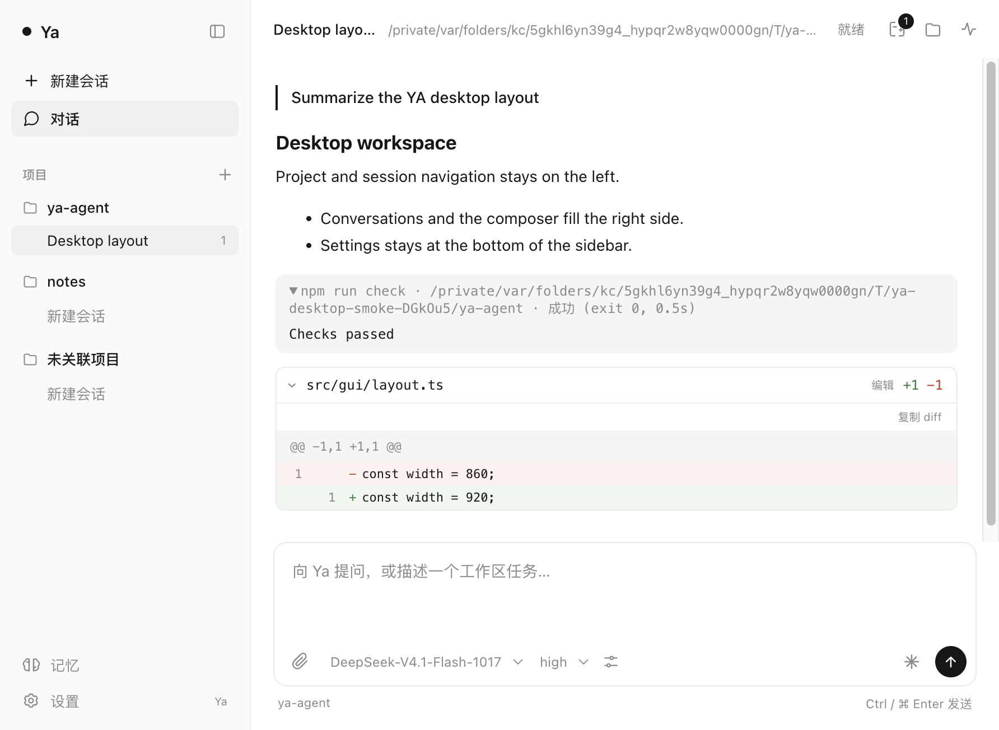

# Ya

[English](README.md) | [中文](README.zh-CN.md)

Ya（丫丫）是一个专门适配 DeepSeek 的 Coding Agent，同时提供命令行与原生桌面应用。项目内核采用 TypeScript，桌面端采用 Electron，并与 CLI 共享同一套带类型的服务层。

Ya 使用 DeepSeek API（默认 `DeepSeek-V4.1-Flash`，可切换到 `DeepSeek-V4-Pro-0813`），在本地保存长期记忆，并且只有在用户明确确认后才会启动受限的 Tree of Agents（ToA）。命令执行需要为每次任务显式开启，并单独批准。

## 桌面界面

左侧导航项目与会话，右侧与 Ya 对话，左下角打开设置。文件、修改后的 diff、相关记忆、工具活动和待确认操作可在详情面板中查看。



## 架构

- **SEA 受控学习**：显式用户反馈先成为候选记忆卡；只有已批准的卡片才会影响后续任务。
- **ICM 好奇心循环**：回答标记出一个重要证据缺口时，Ya 最多执行一次受限的来源探索。
- **受限 ToA**：一个根协调 Agent 最多使用两个临时工作 Agent，并受 Token 与超时预算约束。
- **共享类型核心**：CLI 和桌面端复用配置、记忆、编排、API、网页检索和本地工作区模块。
- **代码验证**：已批准的命令返回退出码与有大小上限的输出，Ya 可以运行测试、类型检查和构建，修复失败原因后再次验证。
- **视觉输入**：CLI 与桌面端都可把经过校验的 JPEG、PNG、GIF 和 WebP 输入发送给原生支持视觉的 `deepseek-flash`。API Key 使用 Chat Completions，平台账号使用 Messages。
- **隔离桌面渲染器**：Electron 渲染进程没有 Node.js 或直接文件系统权限；特权操作通过窄化的 preload 桥接进入主进程。

## 平台支持

独立 CLI 和桌面 Release 产物是自包含文件，不要求安装 Node.js。源码开发或安装 npm 包需要 Node.js 22 或更高版本。

| 操作系统 | CLI | 桌面 GUI | API 密钥存储 |
| --- | --- | --- | --- |
| macOS Apple Silicon / Intel | 独立可执行文件 | 原生 `.app` | macOS 钥匙串或 `DEEPSEEK_API_KEY` |
| Linux x64（glibc） | 独立可执行文件 | AppImage | `DEEPSEEK_API_KEY` 或 GUI 会话密钥 |
| Windows x64 | 独立 `.exe` | 便携 `.exe` | `DEEPSEEK_API_KEY` 或 GUI 会话密钥 |

三个平台均支持浏览器账号登录。API 密钥命令 `ya auth deepseek` 仅支持 macOS，因为它调用系统的 `security` 工具。Linux 和 Windows 的 API Key 用户可使用 `DEEPSEEK_API_KEY`，或在设置页输入仅本次会话使用的密钥。

## DeepSeek 开放平台账号登录

在桌面端打开 **设置 → DeepSeek 开放平台账号 → 登录 DeepSeek**。Ya 会在浏览器中打开 [DeepSeek 开放平台](https://platform.deepseek.com/)，由你完成登录与授权，然后返回 Ya。等待期间可以取消登录，登录后可在同一设置卡片中退出。

CLI 使用同一套浏览器授权流程：

```sh
ya login deepseek
ya auth-status deepseek
ya ask "介绍一下这个项目" --web off
ya logout deepseek
```

命令和浏览器应在同一台电脑运行。浏览器未自动打开时，可手动打开 CLI 输出的链接；按 Ctrl+C 取消。回调仅监听 `127.0.0.1` 的临时端口，授权最多等待十分钟。

账号登录遵循 [DeepSeek 官方 Harness 的 PKCE 实现](https://github.com/deepseek-ai/deepseek-harness/tree/master/packages/credentials/deepseek-account-platform)。Ya 获取平台账号凭证，并通过 `x-dsh-auth-token` 请求头调用官方 Messages API，无需向 Ya 提供账号密码。可用权限和计费取决于你的开放平台账号。登录期间优先使用账号；退出会删除本机账号凭证并尝试撤销平台会话，已有 API Key 仍可使用。账号凭证失效时会提示重新登录。

macOS 的账号凭证保存在 Keychain 中，使用与 API Key 不同的服务项。CLI 和 GUI 对同一数据目录共用凭证；更改 `YA_HOME` 会选择独立的服务项。已有明文记录会迁移至 Keychain，只有保存并回读验证成功后才删除原文件。Keychain 访问或迁移失败时，Ya 会报错并保留已有凭证文件；请解锁 Keychain 后重试，或运行 `ya logout deepseek` 移除登录。

Linux 和 Windows 仍以明文（未加密的 JSON）保存账号凭证，与普通设置分开，路径为 `~/.ya/auth/credentials.json`（或 `$YA_HOME/auth/credentials.json`）。Linux 的目录和文件权限分别为 `0700`、`0600`；Windows 沿用目录访问控制。这些控制限制访问但不会加密凭证。请启用磁盘加密并对备份加密，包括仍待迁移的 macOS 明文记录，并将数据目录保留为私有。凭证不会返回桌面渲染进程或进入会话记录；本地文件工具会阻止读取凭证文件。

## 从 Release tarball 安装 CLI

先安装 Node.js 22 或更高版本，然后从 [GitHub Release 附件](https://github.com/ZedingZhang/ya-agent/releases/latest)下载 `ya-agent-<version>.tgz`。运行命令前，将 `<version>` 替换为下载文件名中的包版本号，不含标签开头的 `v`。进入该文件所在目录后执行：

```sh
npm install -g "./ya-agent-<version>.tgz"
ya --help
```

发布流程将 npm tarball 附加到 GitHub Release，不会将包发布到 npm registry。此包安装 CLI；如需桌面应用或无需 Node.js 的 CLI，请下载单独提供的[独立 Release 产物](#独立-release)。

已发布的 `v0.8.0` tarball 仍使用旧版原生绑定：在干净的 Windows 安装环境中，启动会报 `Cannot find native binding`。基于当前 TypeScript 核心构建的 Release 发布前，请使用[源码安装](#从源码安装)。

## 从源码安装

```sh
git clone https://github.com/ZedingZhang/ya-agent.git
cd ya-agent
npm ci
npm run check
npm link
```

执行 `npm link` 后，当前 Node.js 环境会提供 `ya` 命令。也可以不链接，直接运行：

```sh
npm start -- ask "用通俗语言解释 Graph Engineering"
```

从源码启动桌面端：

```sh
npm run gui
```

## 独立 Release

从[最新 GitHub Release](https://github.com/ZedingZhang/ya-agent/releases/latest)下载对应文件。CLI 与 GUI 分别构建。

### macOS Apple Silicon

```sh
curl -fL -O https://github.com/ZedingZhang/ya-agent/releases/latest/download/ya-macos-arm64
chmod +x ya-macos-arm64
./ya-macos-arm64 ask "用通俗语言解释 Graph Engineering"
```

Intel Mac 使用 `ya-macos-x64`。GUI 压缩包名称分别为 `ya-gui-macos-arm64.zip` 和 `ya-gui-macos-x64.zip`。

### Linux x64

```sh
curl -fL -O https://github.com/ZedingZhang/ya-agent/releases/latest/download/ya-linux-x64
chmod +x ya-linux-x64
./ya-linux-x64 ask "用通俗语言解释 Graph Engineering"
```

桌面 AppImage 发布为 `ya-gui-linux-x64`，运行前需要添加可执行权限。Linux 产物面向 Ubuntu 22.04 等 x64 glibc 系统，不面向 Alpine Linux 等 musl 系统。

### Windows x64（PowerShell）

```powershell
Invoke-WebRequest https://github.com/ZedingZhang/ya-agent/releases/latest/download/ya-windows-x64.exe -OutFile ya-windows-x64.exe
.\ya-windows-x64.exe ask "用通俗语言解释 Graph Engineering"
```

便携桌面端文件名为 `ya-gui-windows-x64.exe`。

### 校验下载

当前发布不包含发布者代码签名或 Apple 公证。macOS 构建可能使用保障运行的临时签名（ad-hoc），该签名不验证发布者身份。macOS Gatekeeper 和 Windows SmartScreen 可能提示或阻止运行，详见[发布签名说明](docs/release-signing.md)。请从同一 Release 下载 `checksums.txt` 并核对 SHA-256：

```sh
shasum -a 256 ya-macos-arm64
# Linux：sha256sum ya-linux-x64
```

```powershell
Get-FileHash .\ya-windows-x64.exe -Algorithm SHA256
```

## CLI 使用

```sh
ya --help
ya ask --help
ya ask "解释递归"
ya ask --web on "比较两种方案的最新证据"
ya ask --thinking on --reasoning-effort max "分析这个决策"
ya ask --image ./chart.png "解释这张图表"
```

交互终端会渲染 Ya 常用的 Markdown。重定向时保留原始 Markdown，方便脚本或文件处理：

```sh
ya ask --format terminal "生成一个简洁表格"
ya ask --format markdown "生成一个简洁表格" > answer.md
```

简单、无工具的回答在交互终端中默认流式输出。网页研究、ToA、本地工作区任务、管道和 Markdown 输出保持缓冲。使用 `--stream off` 可关闭流式输出。

### 视觉输入

视觉能力原生集成在默认模型 `deepseek-flash` 中，无需切换模型即可使用图片；纯文本的 `deepseek-v4-pro` 会拒绝图片。`--image` 可以重复指定，支持本地文件、HTTP(S) URL、base64 data URL，以及已有的 DeepSeek Files API 文件 ID：

```sh
ya ask --image ./chart.png \
  --image https://example.com/photo.webp \
  --image-detail high \
  "比较这些图片并说明重要差异"

ya ask --image file-api-EXISTING_ID "读取这张已上传的图片"
```

`--image-detail` 可取 `auto`（默认）、`low`、`high` 或 `original`。使用 API Key 时，`low` 会在推理前把图片缩放到 512×512；其他取值目前都会保留原图。账号登录支持 `auto`、`high` 和 `original`；本地文件、data URL 和外部图片 URL 选择 `low` 时，会在发送请求前报错。桌面端登录账号后会将此选项标为“仅 API Key”。Files API ID 不受图片细节参数影响。本地文件按照真实文件签名而不是扩展名检查，校验通过后才转换为规范的 data URL；支持 JPEG、PNG、GIF 与 WebP。图片内容只能与 `deepseek-flash` 搭配，并且只会放入 user 消息，符合 DeepSeek 的[视觉理解指南](https://api-docs.deepseek.com/guides/vision/)和 [Chat Completions 参数说明](https://api-docs.deepseek.com/zh-cn/api/create-chat-completion/)。

Ya 会执行 DeepSeek 的 600 张图片上限和外部 URL 8,192 字符上限。单个本地图片或 data URL 的二进制内容最多 32 MiB；为给 base64 膨胀和提示词留出空间、确保请求低于 API 的 48 MiB body 上限，Ya 还会把所有内联图片的二进制总量保守限制为 32 MiB。`file-api-*` 必须指向已经通过 DeepSeek Files API 上传的图片；Ya 不负责上传该文件。

在 ToA 模式下，每张图片都会发送给每个工作 Agent，并再次发送给根协调 Agent；工具调用轮次和最多一次的 ICM 补充在触发时也会重发请求上下文。预检会明确展示这一点，因为 DeepSeek 会按每次请求中的图片 Token 计费。

### Tree of Agents

ToA 由一个根协调 Agent 和一到两个临时证据/风险 Agent 组成，启动前总会展示预检：

```sh
ya ask --toa --toa-workers 2 "评估这个战略决策"
```

非交互环境必须为本次调用显式授权：

```sh
ya ask --toa --yes "评估这个战略决策"
```

`--local` 与 `--toa` 不能同时使用。

### 本地工作区工具

本地模式只为单次任务授予一个受限工作区能力：

```sh
ya ask --local --workspace "$PWD" "根据这里的文本文件创建 notes/summary.md"
```

工具可以：

- 列出目录；
- 读取与搜索有大小上限的 UTF-8 文本；
- 每次创建一个目录；
- 创建或替换文本文件；
- 用版本校验和精确替换局部编辑已有文件；
- 移动或重命名文件与目录。

文件工具不能删除文件。每项变更都会显示绝对路径并等待批准；替换文件时显示最多 200 行的统一 diff。非交互环境默认拒绝文件写入，只有本次调用带 `--approve` 时才允许。

读取始终限制在解析后的工作区中。符号链接逃逸、`.git`、`.env`、凭据、私钥、二进制文件、非法 UTF-8 和超过 1 MiB 的文件都会被阻止。写入、局部编辑和移动也会在审批前拒绝敏感路径。操作审计只记录元数据，不记录文件内容或 diff；日志达到 1 MiB 后轮转，并保留三份归档。

搜索最多返回 100 条文件名或文本匹配。递归遍历会跳过任意层级中名为 `node_modules`、`dist` 和 `.next` 的目录。显式将这些目录指定为搜索起点时，会搜索其内容；排除规则仍适用于内部的子目录。

修改已有文件时，Ya 优先使用 `local_edit`：`local_read` 返回原始内容和 SHA-256 `revision`，编辑请求将其作为 `expected_revision`，并提交 1–100 组 `{old_text, new_text}`。每段非空 `old_text` 必须在原文件中精确且唯一匹配；匹配缺失、不唯一或范围重叠时，整批修改会在审批前被拒绝。插入内容时带上周围原文作为定位上下文，删除内容时将 `new_text` 设为空。工具不做模糊匹配或换行归一化。

审批会显示最终差异。批准后，工具重新检查路径、文件身份、权限和内容，再通过同目录原子重命名提交整批修改。有冲突时必须重新读取并生成编辑请求。重命名只需要目录的写权限，因此只读文件会被拒绝，避免改写用户主动保护的文件。未修改的内容字节（包括 BOM 和换行）会保留，普通权限位以及平台支持的所有者和属组也会保留；无法恢复所有者时工具会拒绝写入，而不是把文件转归当前账户。由于发布方式是替换为新文件，ACL、扩展属性和硬链接不会延续，指向旧文件的其他链接仍保留旧内容。局部编辑遵循读取工具的工作区、敏感文件、UTF-8、1 MiB 和取消限制；被拒绝的批次保留原文件。`local_write` 继续用于新建文件和明确需要的整文件替换。

```sh
ya audit clear
ya audit clear --yes  # 非交互环境必须添加
```

### 命令执行与代码验证

使用 `--local --exec` 为编码任务开启 `local_run`。Ya 会读取仓库现有脚本，选择相关测试、类型检查或构建，查看失败输出，修复代码后重新运行检查：

```sh
ya ask --local --exec --workspace "$PWD" "修复这个 bug，并运行相关测试和类型检查"
```

每次审批都会显示完整命令、绝对工作目录和超时时间。桌面端在工作区勾选 **允许命令执行**；命令卡片显示实时 stdout/stderr、完成状态、退出码和耗时。**停止** 会取消待审批操作、API 请求及正在执行的命令进程树；CLI 使用 Ctrl+C。

包含终端控制字符的命令会在审批前被拒绝，允许 LF 换行和制表符。CLI 审批会将文件路径及差异中的控制字符显示为可见转义文本。库调用方给 `runTask` 传入 `signal` 即可取消本地工具和待审批操作，无需再给 `LocalWorkspace` 配置第二个信号。

无人值守任务分别授权文件变更与命令：

```sh
ya ask --local --exec --approve --approve-commands --no-feedback "修复这个 bug 并验证"
```

`--approve-commands` 允许本次非交互调用中的全部命令。`--approve` 和 `--yes` 不会授权命令；交互终端仍逐条询问。

Windows 使用 `cmd.exe /d /s /c`，macOS/Linux 使用 `/bin/sh -c`，沿用已安装的项目工具链，stdin 关闭。检查应执行一次后退出，避免 watch 模式、交互程序和脱离父进程的后台服务。进程树终止使用操作系统的进程控制；若无法确认清理完成，结果会注明错误并限制输出排空时间，避免任务一直挂起。默认超时 120 秒，模型可以请求 1–600 秒的整数。每次工具结果保留 stdout 与 stderr 各自末尾 64 KiB，并标明是否截断。开启命令的任务最多使用 20 轮工具调用完成查看、修复与验证，其他任务保留 6 轮上限。最终回答需要说明实际执行的检查，以及失败、被拒绝或未完成的检查。

只有命令的 **初始工作目录** 被限制在解析后的工作区内。命令以当前用户权限运行，可修改或删除工作区外文件、访问网络，执行环境并非沙箱。CLI 和 GUI 的命令共用默认环境变量白名单，保留系统和用户目录路径、语言区域、临时目录、终端设置，以及常见 Node.js、Python、Java、Go、Rust、Android 和 .NET 工具链目录。其他继承变量均不传递，包括云服务、CI 和 API 凭据、SSH agent、askpass 辅助程序、`DEEPSEEK_API_KEY`、`YA_HOME` 和应用运行时标志。项目专用变量需在你批准的命令中显式设置；当前账号可读取的文件及其他凭据仍可被命令访问。命令审计记录状态、工作目录元数据、退出码与耗时，不记录命令文本或 stdout/stderr。

批准 `npm install` 或 `npm ci` 也可能执行[依赖的生命周期脚本](https://docs.npmjs.com/cli/v11/using-npm/scripts/#life-cycle-operation-order)，包括 `postinstall`。这些脚本可访问文件、网络及该命令可用的凭据；审批安装命令前，请检查仓库及其依赖。

### 配置

```sh
ya config set model pro
ya config set thinking on
ya config set reasoning-effort max
```

每次 API 请求最多等待 90 秒取得初始响应；非流式请求每次尝试的总时限为 90 秒。流式响应开始后，90 秒空闲超时会随数据或心跳到达而重置，因此持续输出的回答可以超过 90 秒。这些限制同时适用于 API Key 和平台账号，独立于 ToA 工作 Agent 的超时预算。停止按钮或 Ctrl+C 仍可取消请求；流式请求已经交付可见文本后，失败不会触发自动重试。

配置继续兼容旧 Python 版本，存储在 `~/.ya/config.json`。可设置 `YA_HOME` 选择其他状态目录。已不再提供服务的模型 ID（`deepseek-v4-flash`、`deepseek-v4-flash-vision-exp`、`vision` 别名，以及本项目在 API 拒绝前短暂使用过的 `deepseek-v4.1-flash` 与 `deepseek-v4-pro-0813`）会在加载配置时自动迁移。

### 长期记忆

```sh
ya memory review
ya memory approve CARD_ID
ya memory reject CARD_ID
ya memory revoke CARD_ID
ya memory prune
```

Ya 最多保存 100 张本地记忆卡。候选卡片在批准前不会进入模型上下文。每项任务最多选取三张相关的已批准卡片，排序完全在本地确定，依据包括英文短语/关键词与中文字符 n-gram。`--show-memory` 会在回答前显示本次选取结果。

现有 `~/.ya/memory.json` 格式保持不变，因此从 Python 实现升级不会丢失记忆。

## 桌面应用

桌面端参考 [DeepSeek Harness 官方 Desktop 与侧栏源码](https://github.com/deepseek-ai/deepseek-harness/tree/master/apps/desktop)，采用两栏工作区：

- 左侧导航项目与会话，设置固定在左下角，并保留独立的记忆入口。
- 右侧展示对话记录与紧凑输入框。每个会话的草稿、回答和命令输出会在本地保存，重启后可恢复。后续请求会携带当前会话中之前的用户消息和已完成的回复，也会保留未能获得回答的请求，因此补充 API 密钥后可以直接要求 Ya 继续。应用报错和未完成的回复不会进入模型上下文；之前附加的图片如需再次发送内容，须重新选择。
- 文件、变更和活动面板按需打开，包含文件导航、修改后的 diff、相关记忆和操作审批。出现待确认操作时，面板自动展开。

`local_write` 和 `local_edit` 成功后，对话中会显示可展开的 diff 卡片。点击右上角 **变更** 可集中查看当前会话的文件变更记录；同一文件的多次修改按操作分别保留。diff 使用红绿增删行、修改前后行号和三行上下文，支持展开较长差异和复制。卡片与变更记录随会话保存，切换会话或重启后仍能查看修改当时的差异，无需 Git 仓库。

每条差异最多保存 2,000 行和 128K 字符，超过时明确标记预览截断，统计仍覆盖完整变更；差异计算超时会显示无法预览。敏感路径写入会在审批前被拒绝；非文本写入不保存内容差异。变更记录针对文件工具完成的操作，不包含 shell 命令产生的改动；它保留每次操作的差异，不计算整个会话的净差异。操作审计与模型工具结果继续只包含元数据。

点击侧栏项目区的 **+** 添加项目，使用 **新建会话** 创建会话，并在项目列表中切换历史会话。Ctrl/⌘+N 新建会话，Ctrl/⌘+B 收起侧栏，Ctrl/⌘+Enter 发送任务。输入框的 **任务选项** 菜单包含本地工具、命令执行、网页检索、ToA 和图片细节设置。

项目文件夹移动或删除后，仍可查看已保存的记录与草稿。打开这些历史会话时，本地工具会被禁用，并清空对上一个项目目录的访问。任务运行中重新加载桌面界面会取消该任务，待它完全退出后再启用会话导航。

应用还提供记忆审查与清理、English/简体中文界面、DeepSeek 配置、ToA 预检、简单回答流式输出、视觉图片选择和审计管理。模型与推理强度控件位于工作区，并会在选择变化后立即保存；默认选中 `deepseek-flash`，添加图片时使用该模型即可。渲染进程只会获得不透明的选择 ID 和展示所需元数据；本地路径与图片字节始终留在主进程，并会在任务结束、清除选择或关闭窗口时释放。

应用不会启动本地 Web 服务。渲染器不能直接访问 Node.js；API 与文件系统操作在 Electron 主进程内通过校验后的 IPC 处理。

## 开发

共享核心、CLI 与 Electron 桌面端均采用 TypeScript；源码开发需要 Node.js 22 或更高版本。

```sh
npm ci
npm run typecheck
npm test
npm run build
npm run smoke:gui
npm run check
```

生产输出写入 `dist/typescript/`，从而避免 `dist/` 中旧的 Python 构建产物意外进入 npm 或 Electron 包。

常用命令：

```sh
npm start -- --help        # 构建并运行 CLI
npm run gui                # 构建并运行 Ya（macOS 使用名为 Ya 的应用包）
npm run smoke:gui          # 加载 IPC/preload/renderer 并验证页面切换
npm run test:watch         # 监听单元测试
npm run package:cli        # 为当前平台打包 CLI
npm run package:gui        # 为当前平台打包 Electron 应用
```

测试覆盖配置/数据兼容、钥匙串回退、记忆排序、本地工作区边界、审计轮转、DeepSeek 请求/重试/SSE/工具循环、视觉输入校验与请求体、网页结果解析、编排、CLI 语义，以及 GUI 控制器和渲染辅助逻辑。GUI 烟测还会真正加载打包边界内的 renderer，并验证页面导航与视觉控件。

## 项目结构

```text
src/
  cli.ts                 CLI 入口与授权流程
  config.ts              经校验的持久化模型配置
  deepseek.ts            DeepSeek HTTP、SSE、重试与工具循环
  images.ts              经校验的视觉来源与内容块
  local.ts               受限本地文件工具与审计日志
  commands.ts            已批准的 shell 执行、输出捕获与进程取消
  memory.ts              候选记忆生命周期与相关性排序
  orchestrator.ts        单 Agent、ToA、网页、本地与 ICM 编排
  service.ts             CLI/GUI 共享任务服务
  terminal.ts            安全终端 Markdown 渲染
  gui/
    main.ts              Electron 主进程与校验后的 IPC
    preload.ts           上下文隔离的窄桥接
    renderer.ts          桌面交互与安全 DOM 渲染
    controller.ts        GUI 状态与共享服务门面
tests/                   Vitest 行为测试
```

## TLS 与代理

请保持证书校验开启。Electron 桌面端使用操作系统的 Chromium 网络栈。Node.js CLI 位于可信企业代理之后时，请配置 Node 支持的 CA 选项（例如 `NODE_EXTRA_CA_CERTS`），不要关闭 TLS 校验。

## 许可证

[MIT](LICENSE)
