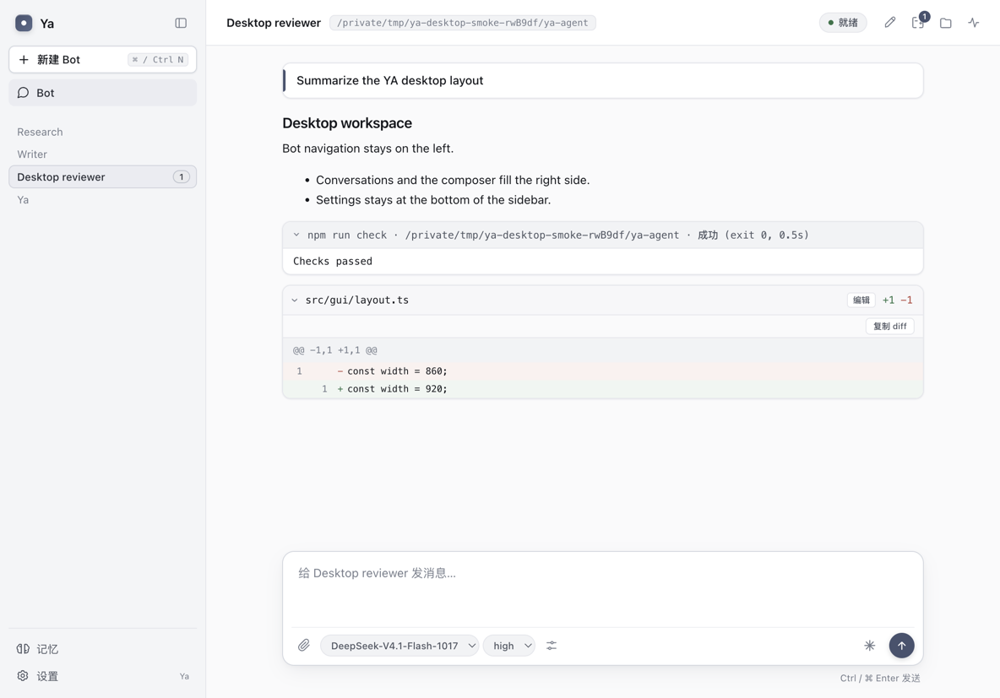
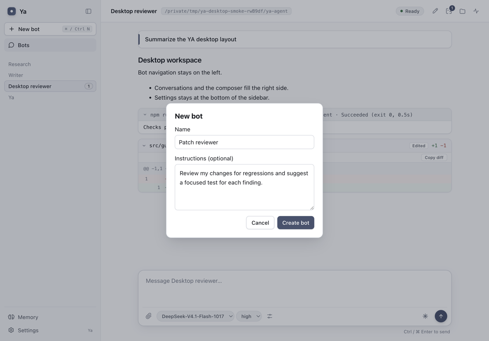
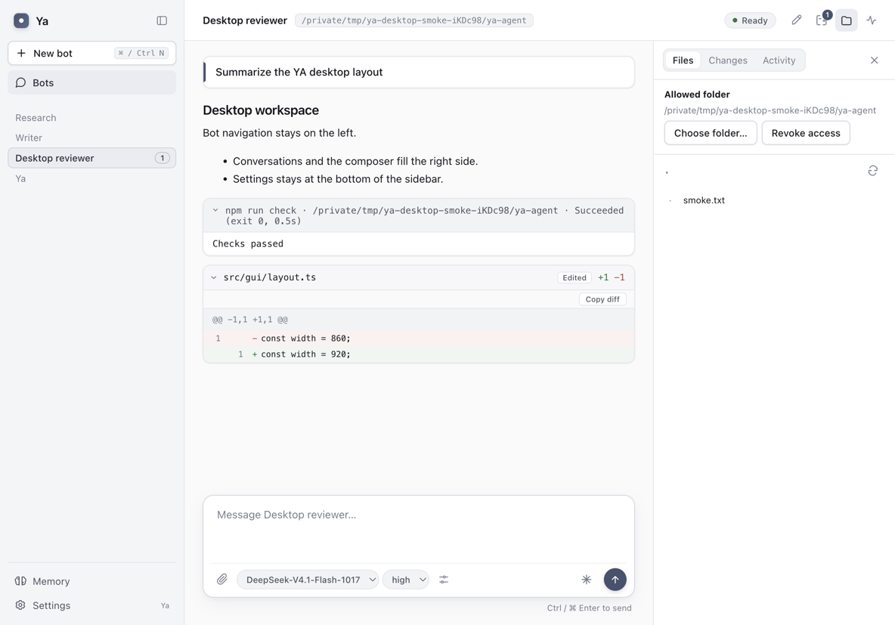
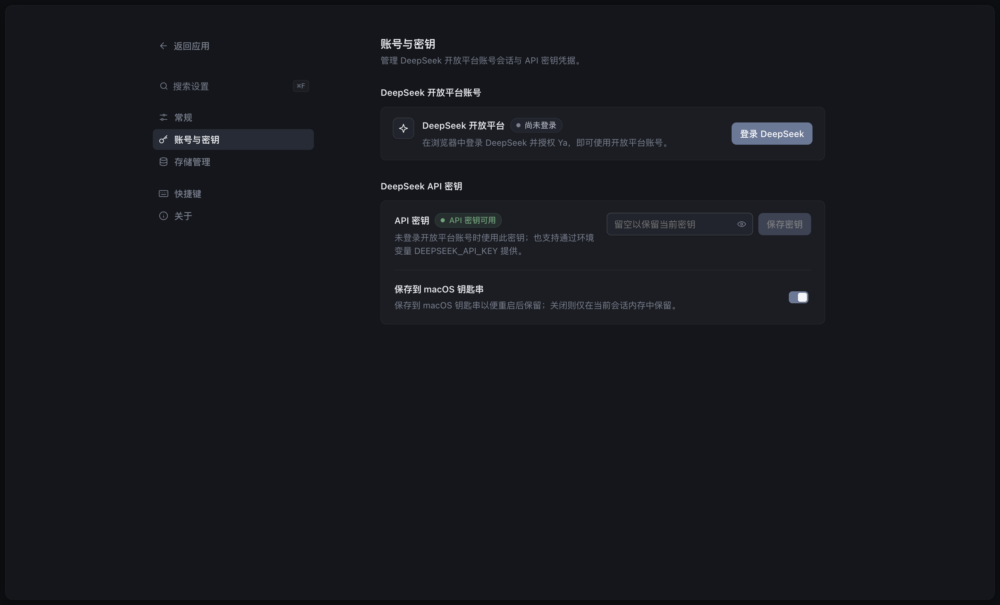

# Ya

[English](README.md) | [中文](README.zh-CN.md)

Ya（丫丫）是一个面向 DeepSeek 的桌面端与 CLI Agent，**用长期存在的具名 Bot 替代一次性会话（session）**。

在桌面端，不用反复开新的临时对话：可以为常用项目或固定分工创建不同的 Bot，每个 Bot 各自保存名字、职责说明、对话历史、草稿和目录权限，重启后直接接着聊。默认使用 `DeepSeek-V4.1-Flash-1017`（支持看图），可切换至 `DeepSeek-V4-Pro-0813`；长期记忆通过 Octop Memory 存在本地 SQLite 中；文件修改前展示 diff 供确认；需要执行 Shell 命令时，可通过 CLI 按次开启 `--local --exec`。

## 桌面界面

可以直接向默认的 **Ya** Bot 发消息，也可以为不同项目或常规任务新建具名 Bot。在侧栏点选任意 Bot 就能接着上次的上下文继续，并在右侧面板查看它的授权目录、文件 diff、相关记忆、工具活动与待确认操作。



## 核心特性

- **用 Bot 替代 Session**：按角色或项目创建具名 Bot 并设置职责说明，各自保留草稿、对话历史和文件变更记录，重启后直接续聊，不用在一堆临时会话里翻找。
- **适配 DeepSeek 模型与账号**：支持 `deepseek-flash`（`DeepSeek-V4.1-Flash-1017`，支持图片）与 `deepseek-v4-pro`（`DeepSeek-V4-Pro-0813`），支持三档思考强度（`low`、`high`、`max`），可用开放平台浏览器登录（PKCE）或 API Key。
- **按 Bot 授权目录与 diff 确认**：桌面 Bot 默认无任何本地目录权限，需为单个 Bot 显式授权文件夹；文件工具不能删除文件，每次写入和编辑都会先展示 diff 等你确认；CLI 命令执行（`--local --exec`）与 ToA 也需单独确认。
- **可审核的本地长期记忆**：回答后的用户反馈会写入本地 SQLite（`octop-memory==1.0.4`）作为候选记忆，只有经你批准的条目才会在后续任务中召回。
- **联网检索与 Tree of Agents（ToA）**：可选联网检索在关键依据缺失时最多补查一次；ToA 由 1 个协调 Agent 与最多 2 个临时工作 Agent 协作，带 Token 和超时上限，启动前需确认。
- **桌面端与 CLI 共用底层**：两端共享配置、认证、长期记忆与跨进程任务记录；Electron 渲染进程没有 Node.js 或直接文件访问权限，仅通过窄化 preload IPC 桥接与主进程通信。

## 快速开始

### 1. 安装

可从[最新 GitHub Release](https://github.com/ZedingZhang/ya-agent/releases/latest)下载独立 CLI 或桌面端产物（详见[安装与独立 Release 说明](docs/installation.md)），或从源码安装：

```sh
git clone https://github.com/ZedingZhang/ya-agent.git
cd ya-agent
npm ci
python -m pip install octop-memory==1.0.4
npm link
```

> [!NOTE]
> 源码安装与 npm tarball 需要 **Node.js 22+**；长期记忆需要 **Python 3.12+** 并安装 `octop-memory==1.0.4`；从源码构建或测试桌面端还需 **CMake 3.15+** 和 C 编译器。

### 2. 登录 DeepSeek

- **开放平台账号（推荐，全平台可用）：** 在桌面端打开 **设置 → DeepSeek 开放平台账号 → 登录 DeepSeek**，或在 CLI 运行 `ya login deepseek`。
- **API Key：** 配置环境变量 `DEEPSEEK_API_KEY`，在 macOS 通过 `ya auth deepseek` 存入钥匙串，或在桌面端 **设置** 中输入仅本次会话使用的密钥。

macOS 将 API Key 与账号凭证保存在系统钥匙串（Keychain）中；Linux 和 Windows 的平台账号凭证以明文 JSON 保存在 `~/.ya/auth/credentials.json`。存储位置与安全建议见[认证、安全边界与网络配置](docs/security-and-auth.md)。

### 3. 运行 Ya

从源码启动桌面端可使用 `npm run gui`，或直接运行 CLI：

```sh
ya ask "介绍一下这个项目"
ya ask --thinking on --reasoning-effort max "比较这两种架构设计"
ya ask --image ./chart.png "解释这张图表"
ya ask --local --exec --workspace "$PWD" "修复这个 bug 并运行相关测试"
```

## 桌面应用

- **用 Bot 而非 Session：** 默认提供 **Ya**，按 `Ctrl/⌘+N`（**新建 Bot**）可按任务新建具名 Bot 并设置职责说明；每个 Bot 独立保存对话记录与草稿，随时可在顶部点击 **编辑 Bot** 修改。
- **按 Bot 授权目录：** 打开 **文件 → 选择文件夹… → 授予访问权限** 将文件工具限制在单个目录及其子目录内，并在支持的文件系统上校验原生目录标识；可随时替换或 **撤销授权**。
- **免 Git 文件差异：** `local_write` 与 `local_edit` 成功后会在对话中生成可展开的 diff 卡片，并在右上角 **变更** 面板按操作分别记录变更历史。
- **工作区控制：** `Ctrl/⌘+B` 收起侧栏，`Ctrl/⌘+Enter` 发送任务；模型与推理强度选择即时保存；**任务选项**菜单集中管理本地工具、网页检索、ToA 与图片细节；内置 English / 简体中文界面与**记忆**管理页。
- **权限边界：** 桌面 Bot 仅使用受目录限制的文件工具；已批准的 Shell 命令执行（`--local --exec`）通过 CLI 提供。

<details>
<summary>更多桌面端截图（英文界面示例）</summary>

**新建 Bot 对话框** — 设置 Bot 名称与可选的长期职责指令：



**Bot 目录权限面板** — 在文件面板查看、替换或撤销当前 Bot 的目录访问权限：



**设置界面** — 分类导航、实时搜索与即时保存（`Ctrl/⌘+,`）：



</details>

关于旧会话迁移、diff 截断上限、原子写入与 IPC 隔离的完整说明，请查看[桌面应用指南](docs/desktop.md)。

## CLI 速览

```sh
# 对话、流式输出与 Markdown 管道导出
ya ask "解释递归"
ya ask --web on "比较两种方案的最新依据"
ya ask --format markdown "生成一个简洁表格" > answer.md

# 视觉输入（deepseek-flash）
ya ask --image ./chart.png --image-detail high "解读这张图表"

# Tree of Agents（启动前展示预检；非交互环境需加 --yes）
ya ask --toa --toa-workers 2 "评估这项架构取舍"

# 本地工作区工具与代码验证命令
ya ask --local --workspace "$PWD" "总结 notes 目录内容"
ya ask --local --exec --workspace "$PWD" "修复问题并运行测试套件"

# 配置、长期记忆、认证与审计日志
ya config set model pro
ya config set thinking on
ya config set reasoning-effort max
ya memory review
ya memory approve CARD_ID
ya auth-status deepseek
ya audit clear
ya history clear tasks --older-than 30 --dry-run  # 预览 30 天以前的已结束任务
```

### 模型列表

| CLI 别名 | API 模型 ID | 当前模型版本 | 图片输入 |
| --- | --- | --- | --- |
| `flash`（默认） | `deepseek-flash` | `DeepSeek-V4.1-Flash-1017` | 支持 |
| `pro` | `deepseek-v4-pro` | `DeepSeek-V4-Pro-0813` | 不支持 |

> [!WARNING]
> `--local --exec` 执行的 Shell 命令使用当前用户权限运行，并非沙箱隔离（仅初始工作目录受限于工作区，并使用默认环境变量白名单）。批准命令及依赖安装前请仔细检查内容。

完整参数、工具限制、`local_edit` 版本校验规则与 Octop Memory 配置，请参阅 [CLI、工具、配置与长期记忆参考](docs/cli-and-tools.md)。

## 桌面端与 CLI 对比

| 功能 | 桌面 GUI | CLI |
| --- | --- | --- |
| 具名 Bot 与本地对话记录 | 支持 | 单次任务调用（共享任务记录） |
| 目录范围内的文件工具与 diff 确认 | 支持（按 Bot 目录授权） | 支持（`--local`，可选 `--approve`） |
| 已批准的 Shell 命令执行（`local_run`） | — | 支持（`--local --exec`，可选 `--approve-commands`） |
| DeepSeek 平台账号登录与视觉输入 | 支持 | 支持 |
| 网页检索、ToA 预检与思考强度控制 | 支持 | 支持 |
| Octop Memory 记忆审查与清理 | 支持 | 支持（`ya memory ...`） |

## 平台支持

| 操作系统 | CLI | 桌面 GUI | 凭据存储 |
| --- | --- | --- | --- |
| macOS Apple Silicon / Intel | 独立可执行文件 | 原生 `.app` | 账号与 API Key 均存钥匙串（`ya auth deepseek`），或 `DEEPSEEK_API_KEY` |
| Linux x64（glibc） | 独立可执行文件 | AppImage | 账号存 `~/.ya/auth/credentials.json`（`0600`）；`DEEPSEEK_API_KEY` 或 GUI 会话密钥 |
| Windows x64 | 独立 `.exe` | 便携 `.exe` | 账号存 `~/.ya/auth/credentials.json`（ACL）；`DEEPSEEK_API_KEY` 或 GUI 会话密钥 |

独立 Release 产物自带 JavaScript 运行时。下载说明与 SHA-256 校验见[安装与独立 Release 说明](docs/installation.md)，macOS 签名与公证模式见[发布签名说明](docs/release-signing.md)。

## 欢迎贡献

第一次参与开源？欢迎把你的第一个 PR 提给 Ya！可以从小处入手，比如改进一段文档、补一个测试，或修复自己遇到的小问题。也欢迎使用 AI 工具辅助贡献，无论是读懂代码、编写补丁，还是改进文档。

如果还没想好从哪里入手，可以看看[现有议题](https://github.com/ZedingZhang/ya-agent/issues)。提交 PR 时，简单说说改了什么、为什么改，以及你是怎么验证的。维护者会尽快审阅并回复你的 PR。

## 开发与项目结构

源码开发需要 **Node.js 22+**、**Python 3.12+**（安装 `octop-memory==1.0.4`），以及 **CMake 3.15+** 与 C 编译器。生产编译输出至 `dist/typescript/`。

```sh
npm ci
npm run check              # 类型检查、Vitest 测试与生产构建
npm run smoke:gui          # 加载 Electron IPC/preload/renderer 并验证页面切换
npm run gui                # 构建并启动桌面应用
npm start -- --help        # 构建并运行 CLI
npm run test:watch         # 监听单元测试
npm run package:cli        # 为当前平台打包独立 CLI
npm run package:gui        # 为当前平台打包 Electron 应用
```

```text
src/
  cli.ts                   CLI 入口与确认交互流程
  config.ts                经校验的持久化模型配置
  account.ts               DeepSeek 平台浏览器 PKCE 登录与会话撤销
  credentials.ts           钥匙串与本地文件凭据存储
  keychain.ts              macOS security 钥匙串封装
  deepseek.ts              DeepSeek HTTP、SSE 流式传输、重试与工具循环
  messages.ts              账号登录使用的 DeepSeek Messages API 适配
  images.ts                经校验的视觉来源与内容块
  local.ts                 目录范围内的本地文件工具与审计日志
  edits.ts                 带版本校验的精确文本替换引擎
  publish-edit.ts          保留权限与所有者的原子替换发布
  file-diff.ts             统一 diff 生成与预览截断
  commands.ts              已批准的 Shell 执行、输出上限与进程树取消
  memory.ts                带类型的 Octop Memory 进程适配层
  octop-memory.py          SQLite 记忆生命周期、召回与旧 JSON 迁移
  orchestrator.ts          单 Agent、ToA、网页检索、本地工具与 ICM 编排
  tokens.ts                ToA 累计生成 Token 预算跟踪
  cancellation.ts          共享 AbortSignal 取消传播辅助函数
  tasks.ts                 跨进程持久化任务身份与生命周期存储
  task-store-lock.ts       任务存储跨进程文件锁
  service.ts               CLI/GUI 共享任务服务
  terminal.ts              安全终端 Markdown 渲染器
  web.ts                   网页检索工具与结果解析
  types.ts / version.ts    共享类型定义、index.ts 公开导出与版本号
  gui/
    main.ts                Electron 主进程与经校验的 IPC
    preload.ts             上下文隔离的窄化 preload 桥接
    renderer.ts            桌面交互与安全 DOM 渲染
    controller.ts          GUI 状态与共享服务门面
    layout.ts / menu.ts / markdown.ts / shared.ts / index.html / styles.css / settings.css
    folder-grants.ts       按 Bot 授权目录与原生目录标识校验
    folder-io.ts           目录作用域下的读/写/编辑/搜索
    folder-move.ts         目录作用域下的移动/重命名与原子暂存
    scoped-path.ts         已授权目录内的防符号链接逃逸路径解析
    native/                目录标识、目录移动与授权提交 C 原生辅助工具
tests/                     Vitest 行为与回归测试套件
```

## 深入文档

所有参考指南位于 `docs/`（英文）：

- [安装与独立 Release（Installation & Standalone Releases）](docs/installation.md) — 独立可执行文件、npm tarball、源码安装与 SHA-256 校验
- [桌面应用指南（Desktop Application Guide）](docs/desktop.md) — 具名 Bot、目录授权、diff 机制、原子写入与渲染器隔离
- [CLI、工具、配置与长期记忆（CLI, Tools & Memory）](docs/cli-and-tools.md) — 命令参数、模型表、视觉输入、ToA、本地工具、`--exec` 与 Octop Memory
- [认证、安全边界与网络配置（Security & Auth）](docs/security-and-auth.md) — PKCE 登录、钥匙串/明文存储、环境变量白名单与 TLS 代理
- [发布签名说明（Release Signing）](docs/release-signing.md) — macOS Developer ID / 临时签名、公证与校验

## 许可证

[MIT](LICENSE)
